# Практична робота №6. Розробка власного API

**Дисципліна:** Сучасні технології розробки WEB-застосувань мовою PHP
**Варіант:** 12 — Онлайн-опитування/анкети
**Ресурс:** `questions` (`id`, `text`, `type`)
**Виконав:** _Унятицький Антон Дмитрович, група ІО-45_

---

## Зміст

1. [Мета роботи](#мета-роботи)
2. [Структура проєкту](#структура-проєкту)
3. [Запуск](#запуск)
4. [Контракт API](#контракт-api)
5. [Коди статусу](#коди-статусу)
6. [Результати тестування](#результати-тестування)
   - [GET](#get)
   - [POST: створення](#post-створення)
   - [POST: доменна дія `stats`](#post-доменна-дія-stats)
   - [Некоректні запити](#некоректні-запити)
7. [Висновок](#висновок)

---

## Мета роботи

Спроєктувати й реалізувати простий API на PHP без фреймворків:

- єдина точка входу (`api.php`) з маршрутизацією за параметрами URL і HTTP-методом;
- узгоджений формат JSON-відповіді;
- коректні коди статусу HTTP для різних сценаріїв (успіх, помилка клієнта, відсутній ресурс).

## Структура проєкту

```
lab6/
├── api.php
├── db.php
└── survey.db
```

## Запуск

```bash
cd lab6
php -S localhost:8000
```

Після запуску API доступне за адресою `http://localhost:8000/api.php`.

## Контракт API

Усі відповіді мають однакову структуру:

```json
{ "success": true,  "data": "..." }
{ "success": false, "error": "опис помилки" }
```

| Метод | Запит | Опис | Успіх | Помилки |
|-------|-------|------|:-----:|---------|
| `GET` | `/api.php?resource=questions` | Список усіх питань | `200` | — |
| `GET` | `/api.php?resource=questions&id=N` | Одне питання за `id` | `200` | `404`, `400` |
| `POST` | `/api.php?resource=questions` | Створення питання | `201` | `400` |
| `POST` | `/api.php?resource=questions&action=stats` | Кількість питань кожного типу (`GROUP BY type`) | `200` | — |

**Тіло запиту для створення** (JSON):

| Поле | Обов'язкове | Правила |
|------|:-----------:|---------|
| `text` | так | непорожній рядок, до 255 символів |
| `type` | так | одне зі значень: `text`, `rating`, `yesno` |

## Коди статусу

| Код | Значення | Коли повертається |
|:---:|----------|-------------------|
| `200` | OK | успішний `GET`, успішна дія `stats` |
| `201` | Created | питання створено (є заголовок `Location`) |
| `400` | Bad Request | некоректний `id`, відсутнє або невалідне поле, невідома `action` |
| `404` | Not Found | невідомий `resource` або питання з таким `id` немає |
| `405` | Method Not Allowed | метод не `GET` і не `POST` (заголовок `Allow: GET, POST`) |
| `500` | Internal Server Error | помилка бази даних |

---

## Результати тестування

Усі запити виконано через `curl -i`, щоб було видно код статусу та заголовки.

### GET

#### 1. Список питань — `200 OK`

```bash
curl -i "http://localhost:8000/api.php?resource=questions"
```

```http
HTTP/1.1 200 OK
Content-Type: application/json; charset=utf-8

{"success":true,"data":[{"id":1,"text":"Як вас звати?","type":"text"},{"id":2,"text":"Яка ваша улюблена мова програмування?","type":"text"},{"id":3,"text":"Оцініть зручність курсу (1-5)","type":"rating"},{"id":4,"text":"Оцініть складність практикумів (1-5)","type":"rating"},{"id":5,"text":"Оцініть якість методичних матеріалів (1-5)","type":"rating"},{"id":6,"text":"Чи користувалися ви раніше PHP?","type":"yesno"},{"id":7,"text":"Чи хотіли б ви продовжити вивчення веб-розробки?","type":"yesno"},{"id":8,"text":"Що б ви змінили в курсі?","type":"text"}]}
```

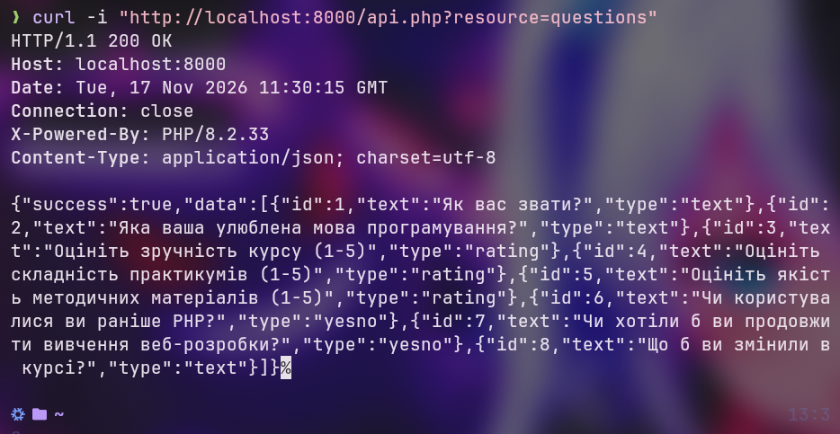

#### 2. Одне питання — `200 OK`

```bash
curl -i "http://localhost:8000/api.php?resource=questions&id=3"
```

```http
HTTP/1.1 200 OK
Content-Type: application/json; charset=utf-8

{"success":true,"data":{"id":3,"text":"Оцініть зручність курсу (1-5)","type":"rating"}}
```

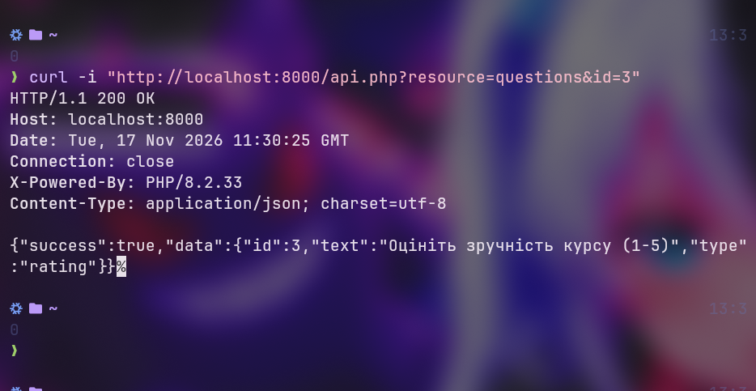

#### 3. Неіснуючий `id` — `404 Not Found`

```bash
curl -i "http://localhost:8000/api.php?resource=questions&id=999"
```

```http
HTTP/1.1 404 Not Found
Content-Type: application/json; charset=utf-8

{"success":false,"error":"Питання з id=999 не знайдено"}
```

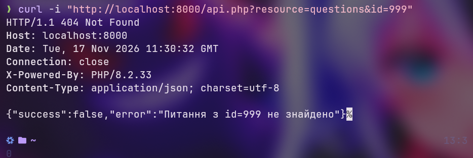

#### 4. Некоректний `id` — `400 Bad Request`

```bash
curl -i "http://localhost:8000/api.php?resource=questions&id=abc"
```

```http
HTTP/1.1 400 Bad Request
Content-Type: application/json; charset=utf-8

{"success":false,"error":"Параметр \"id\" має бути додатним цілим числом"}
```

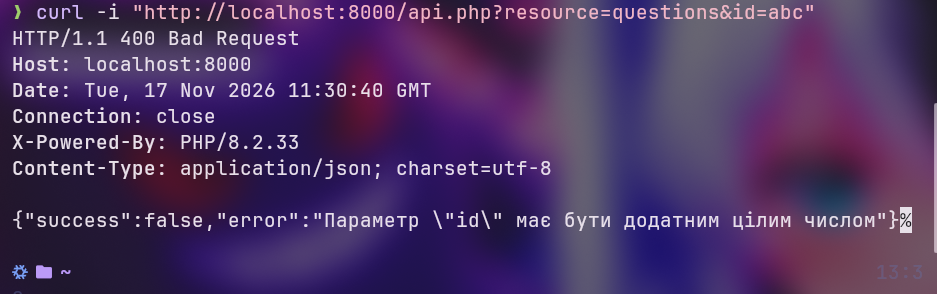

---

### POST: створення

#### 5. Успішне створення — `201 Created`

```bash
curl -i -X POST "http://localhost:8000/api.php?resource=questions" \
  -H "Content-Type: application/json" \
  -d '{"text":"Яка ваша улюблена база даних?","type":"text"}'
```

```http
HTTP/1.1 201 Created
Content-Type: application/json; charset=utf-8
Location: api.php?resource=questions&id=9

{"success":true,"data":{"id":9,"text":"Яка ваша улюблена база даних?","type":"text"}}
```

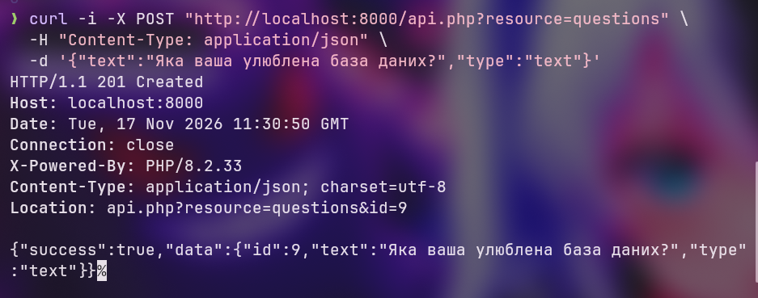

#### 6. Відсутнє поле `type` — `400 Bad Request`

```bash
curl -i -X POST "http://localhost:8000/api.php?resource=questions" \
  -H "Content-Type: application/json" \
  -d '{"text":"Без типу"}'
```

```http
HTTP/1.1 400 Bad Request
Content-Type: application/json; charset=utf-8

{"success":false,"error":"Поле \"type\" обов'язкове"}
```

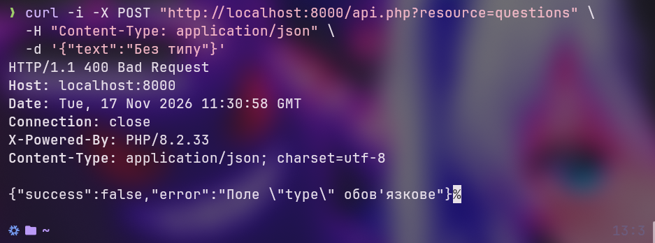

#### 7. Відсутнє поле `text` — `400 Bad Request`

```bash
curl -i -X POST "http://localhost:8000/api.php?resource=questions" \
  -H "Content-Type: application/json" \
  -d '{"type":"text"}'
```

```http
HTTP/1.1 400 Bad Request
Content-Type: application/json; charset=utf-8

{"success":false,"error":"Поле \"text\" обов'язкове"}
```

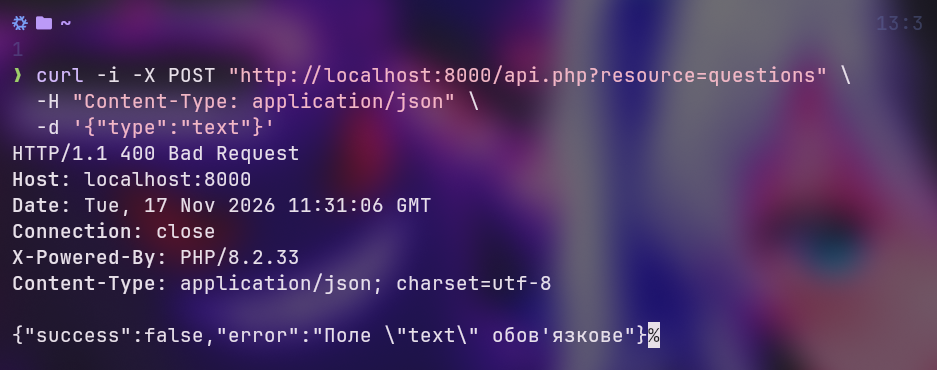

#### 8. Недопустиме значення `type` — `400 Bad Request`

```bash
curl -i -X POST "http://localhost:8000/api.php?resource=questions" \
  -H "Content-Type: application/json" \
  -d '{"text":"Тест","type":"abc"}'
```

```http
HTTP/1.1 400 Bad Request
Content-Type: application/json; charset=utf-8

{"success":false,"error":"Поле \"type\" має бути одним із: text, rating, yesno"}
```

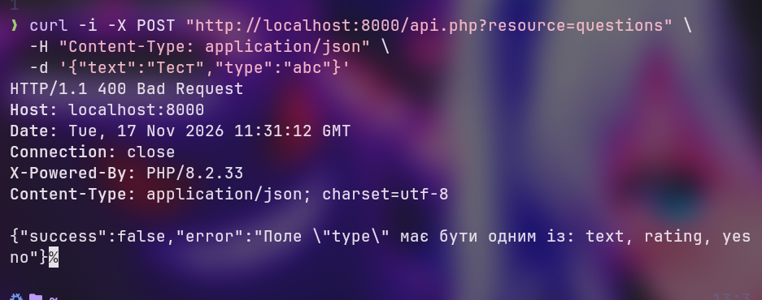

---

### POST: доменна дія `stats`

#### 9. Статистика за типами — `200 OK`

```bash
curl -i -X POST "http://localhost:8000/api.php?resource=questions&action=stats"
```

```http
HTTP/1.1 200 OK
Content-Type: application/json; charset=utf-8

{"success":true,"data":[{"type":"rating","count":3},{"type":"text","count":4},{"type":"yesno","count":2}]}
```

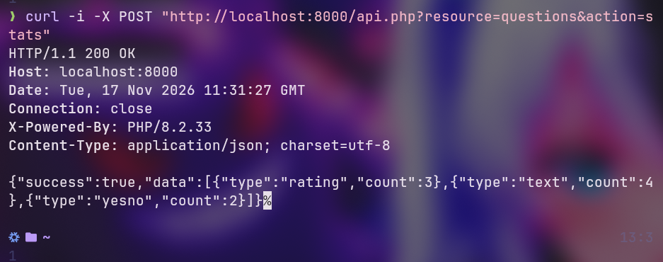

#### 10. Невідома дія — `400 Bad Request`

```bash
curl -i -X POST "http://localhost:8000/api.php?resource=questions&action=foo"
```

```http
HTTP/1.1 400 Bad Request
Content-Type: application/json; charset=utf-8

{"success":false,"error":"Невідома дія: foo"}
```

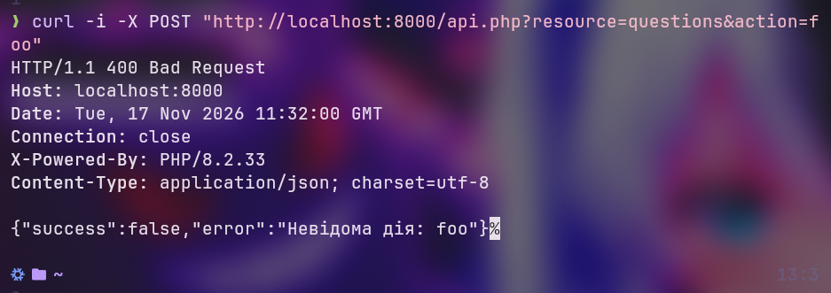

---

### Некоректні запити

#### 11. Метод `DELETE` — `405 Method Not Allowed`

```bash
curl -i -X DELETE "http://localhost:8000/api.php?resource=questions&id=1"
```

```http
HTTP/1.1 405 Method Not Allowed
Content-Type: application/json; charset=utf-8
Allow: GET, POST

{"success":false,"error":"Метод DELETE не підтримується для ресурсу questions"}
```

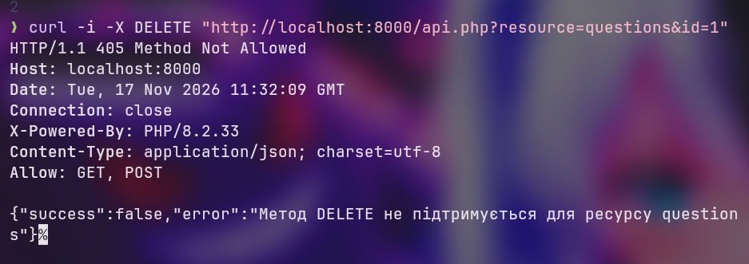

#### 12. Метод `PUT` — `405 Method Not Allowed`

```bash
curl -i -X PUT "http://localhost:8000/api.php?resource=questions&id=1"
```

```http
HTTP/1.1 405 Method Not Allowed
Content-Type: application/json; charset=utf-8
Allow: GET, POST

{"success":false,"error":"Метод PUT не підтримується для ресурсу questions"}
```

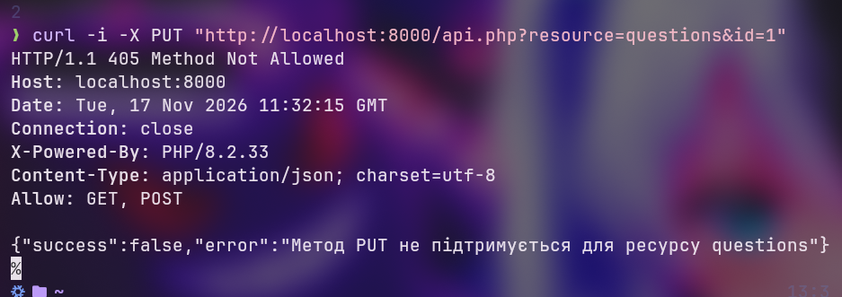

#### 13. Невідомий ресурс — `404 Not Found`

```bash
curl -i "http://localhost:8000/api.php?resource=foo"
```

```http
HTTP/1.1 404 Not Found
Content-Type: application/json; charset=utf-8

{"success":false,"error":"Невідомий ресурс"}
```

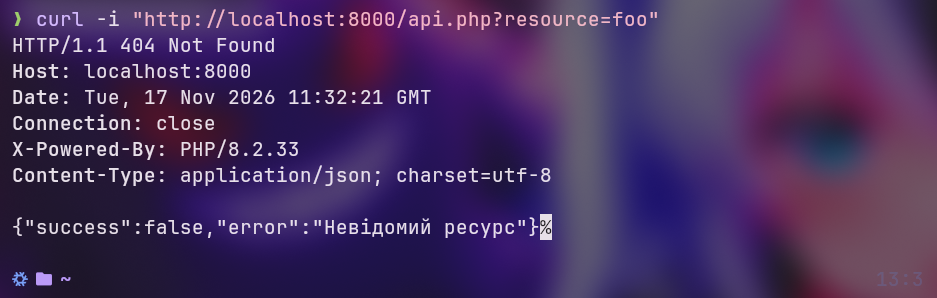

---

## Підсумок тестів

| № | Запит | Очікуваний код | Фактичний код |
|:-:|-------|:--------------:|:-------------:|
| 1 | `GET` список | 200 | 200 ✅ |
| 2 | `GET` `id=3` | 200 | 200 ✅ |
| 3 | `GET` `id=999` | 404 | 404 ✅ |
| 4 | `GET` `id=abc` | 400 | 400 ✅ |
| 5 | `POST` створення | 201 | 201 ✅ |
| 6 | `POST` без `type` | 400 | 400 ✅ |
| 7 | `POST` без `text` | 400 | 400 ✅ |
| 8 | `POST` `type=abc` | 400 | 400 ✅ |
| 9 | `POST` `action=stats` | 200 | 200 ✅ |
| 10 | `POST` `action=foo` | 400 | 400 ✅ |
| 11 | `DELETE` | 405 | 405 ✅ |
| 12 | `PUT` | 405 | 405 ✅ |
| 13 | `resource=foo` | 404 | 404 ✅ |

## Висновок

У роботі реалізовано API для ресурсу `questions` на чистому PHP із єдиною точкою входу `api.php`. Маршрутизація виконується за методом HTTP та параметрами `resource`, `id`, `action`. Усі відповіді мають єдину структуру `{"success": ..., "data"/"error": ...}`, а коди статусу (200, 201, 400, 404, 405, 500) відповідають сценаріям використання. Запити до БД виконуються через підготовлені вирази PDO, тому API захищене від SQL-ін'єкцій. Усі маршрути перевірено вручну за допомогою `curl -i`.