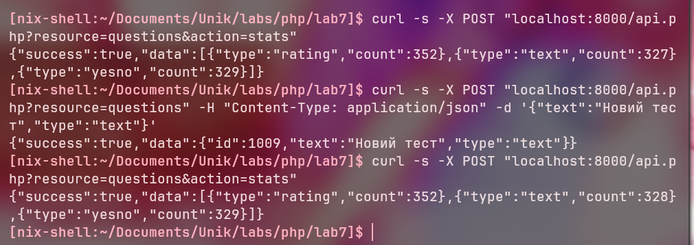
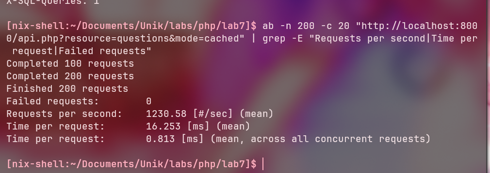

# Практична робота №7. Експерименти з підвищеним навантаженням: оптимізація серверних скриптів

**Варіант:** 12 — Онлайн-опитування/анкети
**Виконав:** _Унятицький Антон Дмитрович, група ІО-45_

---

## Мета роботи

Навчитися вимірювати продуктивність PHP-застосунку (час, пам'ять), проводити навантажувальне тестування за допомогою Apache Bench (`ab`) і застосовувати базові оптимізації: індекс БД, усунення N+1 та кешування.

## Завдання варіанта

| Пункт | Реалізація |
|-------|------------|
| Навантаження | `GET /api.php?resource=questions` |
| Індекс | стовпець `type` |
| N+1 | для кожного питання окремий запит «скільки питань цього типу» → один `countByType()` (`GROUP BY type`) |
| Кеш | результат `countByType()` (файловий кеш, TTL 60 с) |

## Що змінено в API

- Кожна відповідь має заголовки `X-Time-Ms`, `X-Peak-Memory-MB` (`microtime(true)`, `memory_get_peak_usage(true)`) і `X-SQL-Queries` (лічильник `query()`/`exec()`/`execute()`).
- Список питань містить `type_count` (кількість питань того самого типу) у трьох режимах `?mode=`: `n1` (запит на кожне питання), `group` (один `GROUP BY`), `cached` (`GROUP BY` + файловий кеш).
- Після `POST` кеш видаляється явно, тому дані не застарівають.

Умови вимірювань: **1008** питань у таблиці (8 початкових + `php tools.php seed 1000`), `ab -n 200 -c 20`, вбудований сервер `php -S`.

---

## Результати

### 1. Базова лінія (режим `n1`, без індексу)

```bash
curl -s -o /dev/null -D - "http://localhost:8000/api.php?resource=questions&mode=n1" | grep X-
ab -n 200 -c 20 "http://localhost:8000/api.php?resource=questions&mode=n1"
```

```
X-Time-Ms: 154.26
X-Peak-Memory-MB: 2.00
X-SQL-Queries: 1009

Failed requests:        0
Requests per second:    36.17 [#/sec] (mean)
Time per request:       552.944 [ms] (mean)
```


Один HTTP-запит виконує **1009 SQL-запитів**: 1 на список + 1008 у циклі (N+1).

### 2. Індекс по `type`

```bash
php tools.php explain          # до
php tools.php index create     # CREATE INDEX idx_questions_type ON questions (type)
php tools.php explain          # після
```

```
До:     SELECT * FROM questions WHERE type = 'text'
          SCAN questions
Після:  SELECT * FROM questions WHERE type = 'text'
          SEARCH questions USING INDEX idx_questions_type (type=?)
```

Замість повного сканування таблиці (`SCAN`, аналог `type=ALL`) СУБД використовує індекс (`SEARCH`, аналог `type=ref`).

### 3. Усунення N+1 (режим `group`)

```bash
curl -s -o /dev/null -D - "http://localhost:8000/api.php?resource=questions&mode=group" | grep X-
```

```
X-Time-Ms: 3.16
X-SQL-Queries: 2
```

Кількість запитів: **1009 → 2** (список + один `GROUP BY`).

### 4. Кеш (режим `cached`)

```bash
rm -f /tmp/survey_cache_*
curl -s -o /dev/null -D - "http://localhost:8000/api.php?resource=questions&mode=cached" | grep X-   # холодний
curl -s -o /dev/null -D - "http://localhost:8000/api.php?resource=questions&mode=cached" | grep X-   # теплий
```

```
холодний: X-Time-Ms: 3.15   X-SQL-Queries: 2
теплий:   X-Time-Ms: 2.22   X-SQL-Queries: 1
```

Інвалідація: після додавання питання статистика оновилась одразу, а не через 60 с (`text`: 327 → 328).

```bash
curl -s -X POST "http://localhost:8000/api.php?resource=questions&action=stats"
curl -s -X POST "http://localhost:8000/api.php?resource=questions" -H "Content-Type: application/json" -d '{"text":"Новий тест","type":"text"}'
curl -s -X POST "http://localhost:8000/api.php?resource=questions&action=stats"
```



### 5. Вимірювання після оптимізацій (`cached`, індекс, кеш прогрітий)

```bash
curl -s -o /dev/null -D - "http://localhost:8000/api.php?resource=questions&mode=cached" | grep X-
ab -n 200 -c 20 "http://localhost:8000/api.php?resource=questions&mode=cached"
```

```
X-Time-Ms: 2.28
X-Peak-Memory-MB: 2.00
X-SQL-Queries: 1

Failed requests:        0
Requests per second:    1230.58 [#/sec] (mean)
Time per request:       16.253 [ms] (mean)
```



---

## Звіт «до / після»

| Показник | До | Після |
|----------|---:|------:|
| Час одного запиту, мс | 154.26 | 2.28 |
| Пікова пам'ять, МБ | 2.00 | 2.00 |
| SQL-запитів на запит | 1009 | 1 |
| Requests per second | 36.17 | 1230.58 |
| Time per request (mean), мс | 552.944 | 16.253 |
| Failed requests | 0 | 0 |

**Причина різниці:** замість 1009 запитів (по одному `COUNT(*)` на кожне питання) виконується один `GROUP BY type`, а його результат кешується на 60 с, тому звернення до БД для агрегації майже зникає; індекс по `type` прибирає повне сканування таблиці.

## Висновок

У роботі виміряно час виконання, пам'ять і кількість SQL-запитів API `questions`, проведено навантажувальне тестування `ab`. Базовий варіант містив проблему N+1 (1009 запитів на один HTTP-запит). Після усунення N+1 через `GROUP BY type`, додавання індексу `idx_questions_type` та файлового кешу `countByType()` з явною інвалідацією кількість запитів зменшилась до 1, час одного запиту — зі 154 до 2.3 мс (≈68 разів), а пропускна здатність зросла з 36 до 1230 запитів за секунду (≈34 рази) без жодного failed request. Пікова пам'ять не змінилась (2 МБ), оскільки вона визначається обсягом відповіді, а не кількістю запитів. Усі кроки можна відтворити скриптами `run_checks.sh` / `run_checks.ps1`.